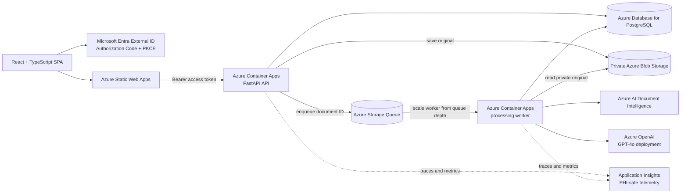
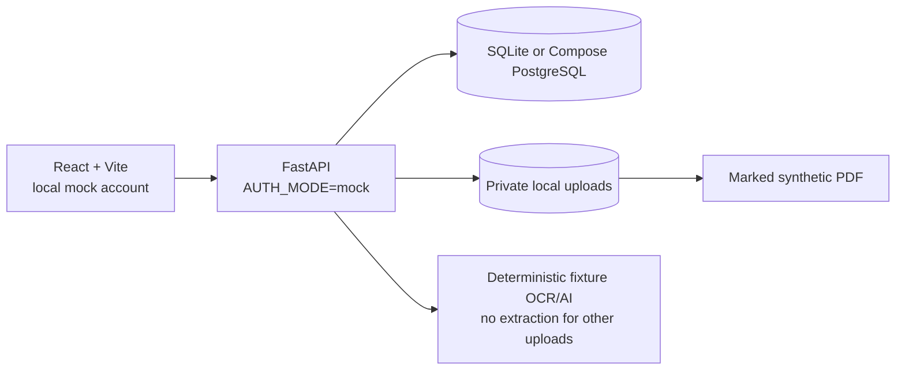

# Carefolio architecture

## Cloud deployment

The API and worker use separate system-assigned managed identities. The API sends queue messages and accesses the configured blob container. The worker processes queue messages, reads blobs, and calls the configured AI resources. Queue messages contain document IDs, not document text or health values. The database remains the authority for job status and owner-scoped records.

## Local development

The local mock processes only the exact included synthetic PDF fixture. Other user uploads are not given fabricated OCR text or medical information and finish in `needs_review`. The prototype is for synthetic or properly de-identified documents only and is not for clinical decision-making.
