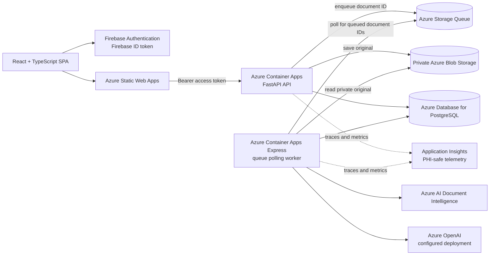
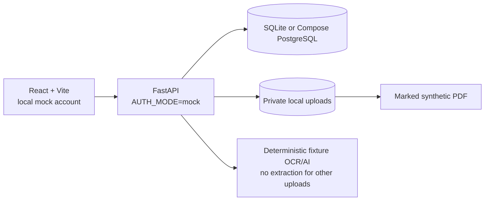

# Carefolio architecture

## Cloud deployment

The API and worker use separate user-assigned managed identities, and a third user-assigned identity grants image-pull access to the existing Azure Container Registry. The API sends queue messages and accesses the configured blob container. The worker polls the queue continuously because the Express environment does not support the custom queue scaler used by standard Container Apps environments. Stop or scale down the worker when the demo is idle to limit charges. Queue messages contain document IDs, not document text or health values. The database remains the authority for job status and owner-scoped records.

The FHIR R4 download is a prototype export containing only recorded data. Demo patient identifiers are explicitly marked as mock identifiers. The local ABHA linking control is a visual demo state only; the app does not connect to ABDM or government systems.

## Local development

The local mock processes only the exact included synthetic PDF fixture. Other user uploads are not given fabricated OCR text or medical information and finish in `needs_review`. The prototype is for synthetic or properly de-identified documents only and is not for clinical decision-making.
